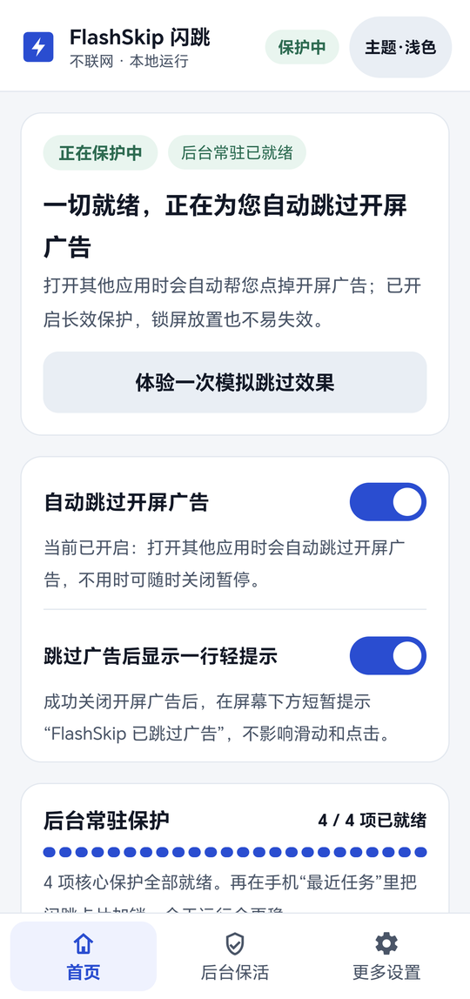
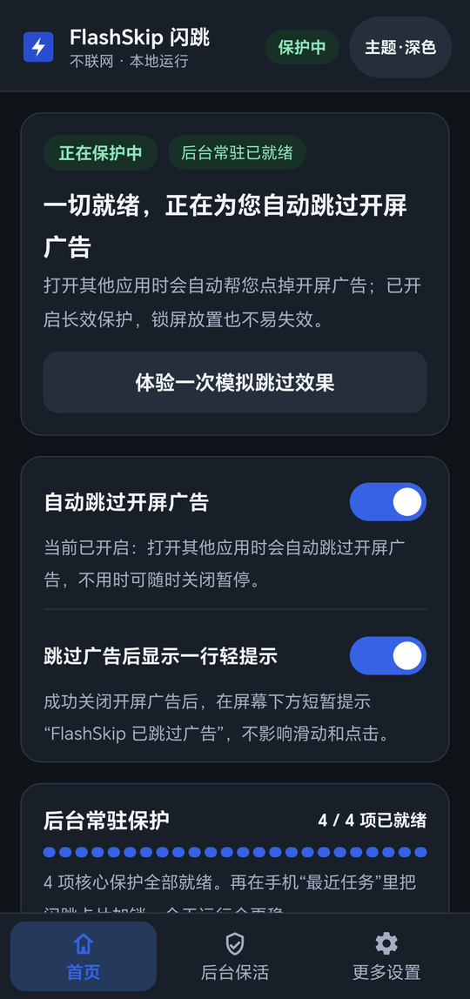
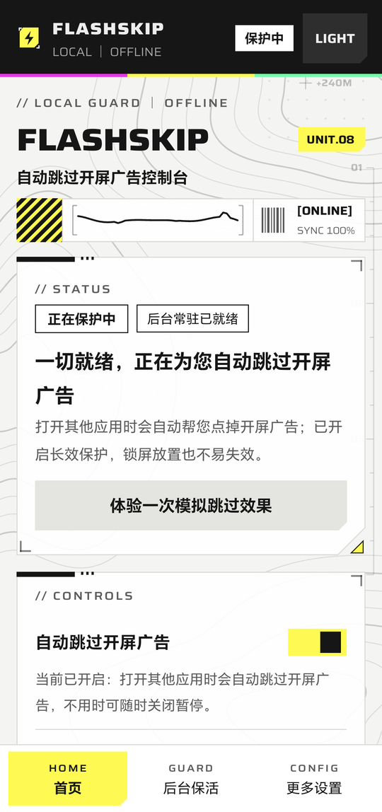
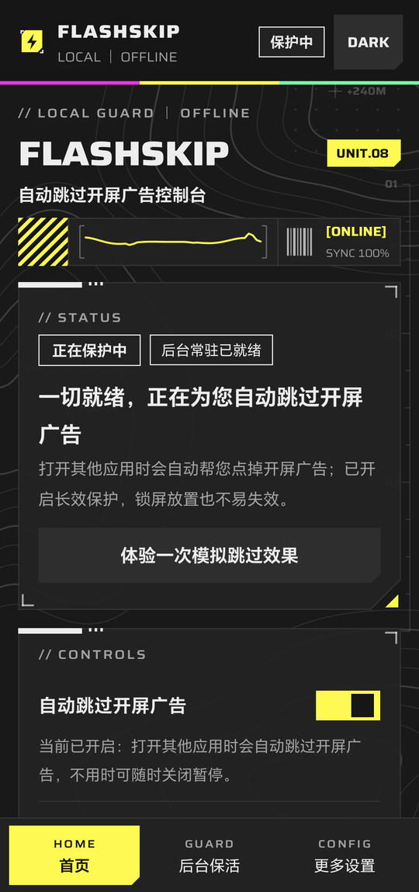
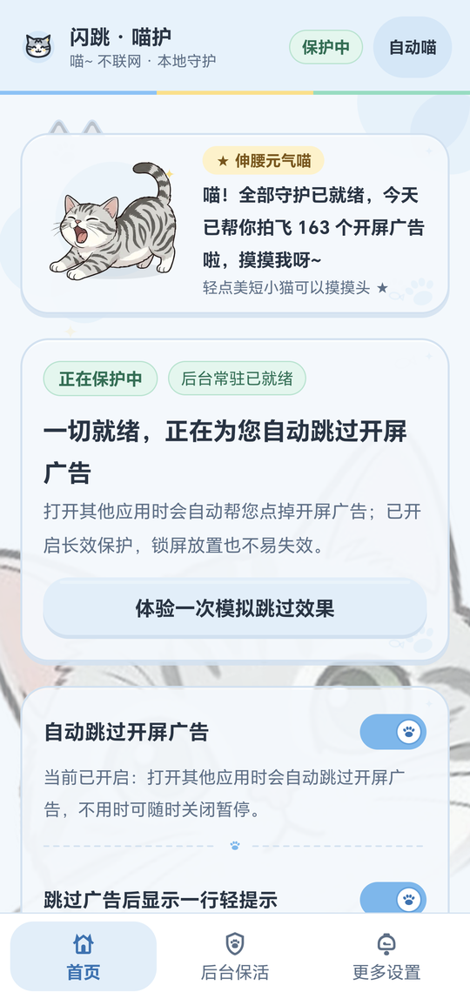
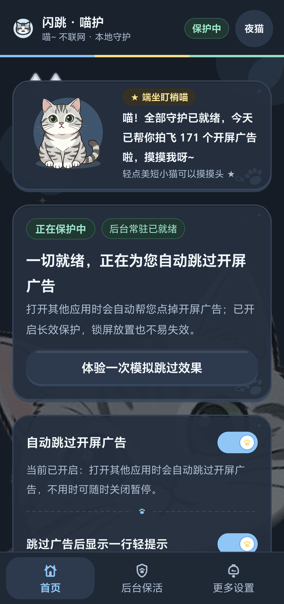
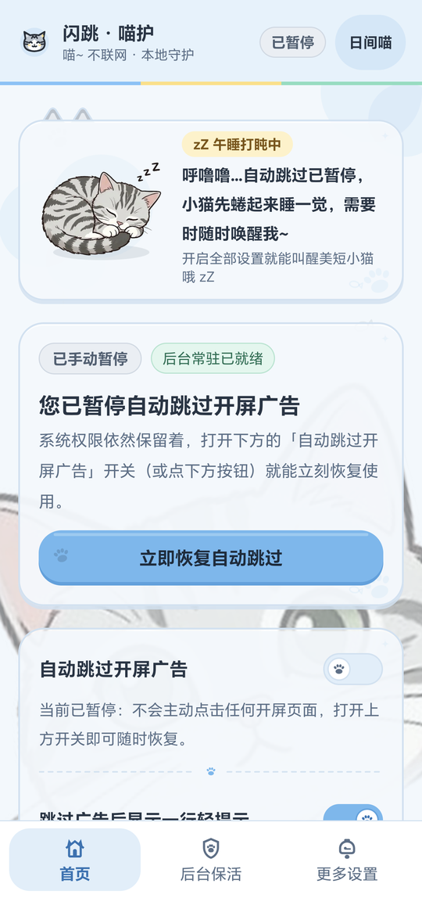
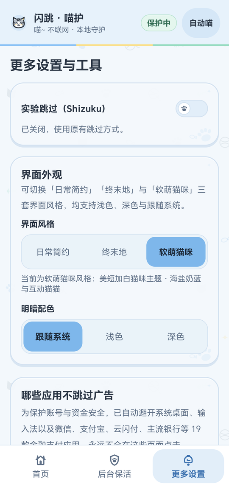

<h1>
  
  FlashSkip（闪跳）
</h1>

[](#)
[](https://kotlinlang.org)
[-3DDC84.svg)](https://developer.android.com)
[](#隐私与安全设计)

**FlashSkip** 是一款基于 Android 无障碍服务（`AccessibilityService`）的事件驱动开屏广告自动跳过工具——**无需 Root、零网络权限、纯本地运行**。通过纯 Kotlin 编写的规则与状态机引擎，在极短延迟内识别并点击“跳过”按钮，同时内置多层防误触机制，防止误点全屏广告落地页或正常业务按钮。

> **v1.2 更新**：收敛为 **纯无障碍（`AccessibilityService`）独立架构并全面强化复杂开屏与物理小窗可靠性**：
> - **彻底移除实验引擎**：移除默认关闭的 Shizuku 实验后端、AIDL 接口、测试文件与设置入口，纯系统无障碍独立运行，体积更轻、权限保持零 `INTERNET`；
> - **复杂开屏与防误触增强**：支持热切场景下的分节点括号倒计时胶囊、同卡片结构化原生关闭、互动视频匿名关闭入口，以及同包顶栏抢焦时的有界底层取根；同时针对同窗仿通知横幅与下移促销诱饵启用精准识别并拦截误跳；
> - **物理小窗（Freeform）贴边与缩放加固**：小窗横向贴边可见宽度下限放宽至 85%、新增系统标题栏精确裁切与小窗拖动/缩放换窗后的迟到状态会话接管，支持同启动窗强证据 SDK 圆环宽限跳过；
> - **响应链路与安全重试升级**：引入 Android 13+ `ContentWindowRoot` 同窗事件根及受限祖先链快速复核、有界宽度优先树预取、`STILL_PRESENT` 有边界重试与快照时龄/前台变化门禁防误触，并提供端到端毫秒级分段诊断；
> - **充分自动化与真机验证**：JVM 单元测试扩充至 **`119 / 119`**（含 29 份脱敏实机节点树回放 `DeviceAuditReplayTest`）；165 份公开广告快照离线评测正例匹配 `48/79`、静态派发 `46/79`、负例误选 `0/86`；同等引擎代码在 80 轮（两次独立 40 轮）真实第三方多广告场景真机复测中，**有效广告跳过 `72 / 73`（98.6%）、物理小窗全形态 `22 / 22`、应用内原生弹窗负例 `4 / 4` 零误触、自动外跳 `0` 次**。
>
> **v1.1.1 更新**：上线 **全链路「一键配置体检」与真实状态校验（彻底消除假绿灯）**——守护通知现联合核验 `POST_NOTIFICATIONS` 运行时权限、通知渠道存活与前台服务运行状态（`foregroundActive`）；将原生「系统未禁止后台」与手机厂商「应用启动管理 / 自启动与后台加锁」拆分展示并引入本地人工核对确认（重装自动清零重检）；在「首页」与「后台保活」页新增「一键配置体检」入口及厂商自启确认按钮，完整适配 **日常简约 / 终末地 / 软萌猫咪** 三套界面主题，并在 5 项体检报告弹窗中直连设置修复与内置「实测跳过一下」闭环校验；JVM 单元测试扩充至 `82 / 82`。
>
> **v1.1 更新**：新增 **侧边栏小窗（自由窗口 / Freeform）开屏自动跳过**（系统装饰栏与窗口层级核验、逻辑/屏幕坐标映射、独立小窗中央列防误触保护，兼容冷启动、30 秒+热重进、熄屏 DOZE 解锁重进与拖动缩放/切回全屏，普通 `Dialog` 与移出屏幕保持零误触）；同步统一「日常简约（Classic）」顶栏品牌图标（`ic_ef_flash_seal.xml`）为新版图标；JVM 单元测试扩充至 `80 / 80`。
>
> **v1.0.3 更新**：修复状态栏常驻通知小图标（`ic_stat_flash.xml`）未同步更新的问题，与新版应用图标保持一致；收紧双引擎跨窗关闭证据校验，仅在输入仍处于对应热重进时段且目标窗口 ID 一致时才采信缓存业务窗，修复普通同包导流误计为 `VERIFIED_CLOSED` 的问题。
>
> **v1.0.2 更新**：全新重设计自适应启动图标（`AdaptiveIcon` 靛紫→电光蓝渐变底 + 被截断的开屏倒计时环 + 闪电跳过符号「⏭」，并支持 Android 13+ 单色主题图标）。
>
> **v1.0.0 正式版**：新增 **三套可随时切换的界面主题（「日常简约 / 终末地 Endfield / 软萌猫咪」）**，强化终末地全屏等高线与二次元战术 HUD、搭载参考美短加白插画多姿态互动猫猫与磨砂大猫头背景；底层继承热重进（Hot Resume）有界延迟补查、未知焦点窗口安全识别、多品牌后台保活直达引导、跳过成功轻提示。

---

## 核心特性（v1.2）

- **一键配置体检与真实状态校验（拒绝假绿灯）**：
  - 守护通知不再只看系统总开关，同步校验 `POST_NOTIFICATIONS` 运行时权限、通知渠道可用性及 `foregroundActive` 前台常驻状态；
  - 将系统原生「未限制后台」与手机厂商管家的「自启动 / 关联启动 / 后台加锁」明确拆开（重装自动清零重检），未手动核对前如实标为「待核对」，并联动终末地 HUD 同步率与软萌猫咪苏醒状态；
  - 在「首页」保活卡片与「后台保活」页提供一键深度体检入口，弹出三套主题自适应的 5 项核验报告（无障碍真实连接 / 前台守护通知 / 电池白名单 / 原生后台限制 / 厂商自启与加锁），支持直达设置页修复与弹窗内「实测跳过」闭环验证。

- **纯无障碍架构与复杂开屏覆盖**：
  - 彻底移除实验后端依赖，仅基于系统 `AccessibilityService` 独立运行，**不依赖、不绑定任何外部软件**；
  - 支持常见文字/ID 跳过、自绘匿名关闭按钮、分节点括号倒计时胶囊、同卡片结构化原生关闭与互动视频匿名关闭入口，并兼容同应用顶部横幅/浅顶栏抢焦时的底层窗识别。
- **全屏 + 侧边栏小窗（Freeform）双形态跳过**：
  - 除传统全屏开屏外，现支持通过系统侧边栏以**自由窗口（小窗模式）**启动应用时自动识别并跳过开屏广告（支持横向贴边最低 85% 可见宽度、系统标题栏精准重叠裁切、拖动缩放换窗及迟到状态事件会话接管）；
  - 通过聚焦窗口、活跃状态、系统装饰栏与窗口层级校验（`FloatingWindowLayers`）及 Manifest 启动 Activity 主题检查，严格区分**真实小窗**与**普通应用内 `Dialog`/悬浮浮层**；
  - 由纯 Kotlin `FreeformViewport` 负责小窗逻辑边界与物理屏幕坐标双向转换，并在小窗内单独强化中央列防误触保护与安全位移重取。

- **三套前端视觉风格 & 全功能浅/深色切换**：
  - **日常简约（Classic）**：高可读性圆润白/夜卡布局，聚焦状态总览、主开关与保活进度条；
  - **终末地（Endfield）**：全屏程序化多层有机等高线、`+240M` / `SEC-04` / `FS//08` 十字准星与右侧标尺、黑黄警示斜纹 + 实时脉冲波形 + 条形码 `[ONLINE] SYNC` 战术 HUD、`Saira` 字体与 45° 切角面板；
  - **软萌猫咪（海盐奶蓝 × 银虎斑美短加白）**：内置行走巡逻、翻肚撒娇、正坐发呆、伸懒腰 4 种苏醒姿态与蜷睡 `Zzz` 姿态；所有必要设置就绪时每次进入首页随机切换苏醒姿态，未完全开启时自动进入午睡状态；首页下半屏采用斜角淡化大猫猫头背景搭配 ~72% 磨砂卡片，保活/设置分页亦配备专属猫元素手账底纹与猫爪就绪度条；
  - 「更多设置」首屏置顶「界面外观」开关，三套风格均支持 **跟随系统 / 浅色 / 深色**。
- **纯无障碍快速取树与严格安全重试**：
  - 在 Android 13+ 引入 `ContentWindowRoot` 同窗事件根与受限祖先链快速复核及有界宽度优先预取（`MATCH_TREE_PREFETCH`），缩短事件到建树耗时，冷启原生胶囊识别至输入调用可低至 `28–40 ms`；
  - 区分 `VERIFIED_CLOSED`（确认关闭）、`STILL_PRESENT`（广告仍在）、`NAVIGATED`（同包导航跳转）与 `UNOBSERVED`（未观测），关闭前刷新原窗口候选树防止缓存掩盖；
  - 遇到广告 SDK 对 `ACTION_CLICK` 返回“假成功”或手势未立即关闭时自动发起有边界二次补点，并通过动作前快照刷新与后台切走门禁（`FOREGROUND_CHANGED` / `TARGET_UNAVAILABLE`）防止页面已切换后的误点击。
- **轻量跳过提示与多品牌后台保活引导**：
  - 引擎确认跳过后可弹出静音、无焦点、零悬浮窗权限的系统轻提示 `FlashSkip 已跳过广告`（支持独立开关与 `1800 ms` 防抖）；
  - 加固深度休眠（Doze）与亮屏/解锁唤醒恢复，内置荣耀、华为、小米、OPPO、vivo、三星、魅族后台自启/保护页直达入口与分步手动引导，独立保留标准电池白名单入口。

---

## 界面预览（三套主题 · 浅/深双色实机截图）

> 以下界面截图全部实拍自真机并已裁剪系统状态栏。

### 1. 日常简约（Classic）

| 浅色首页 | 深色首页 |
| :---: | :---: |
|  |  |

### 2. 终末地（Endfield · 全屏等高线与战术 HUD）

| 浅色控制台 | 深色控制台 |
| :---: | :---: |
|  |  |

### 3. 软萌猫咪（海盐奶蓝 × 银虎斑美短加白）

| 浅色苏醒态（斜角大猫头背景 + 随机姿态） | 深色苏醒态（星空牛仔蓝 + 随机姿态） |
| :---: | :---: |
|  |  |

| 未完全开启/暂停态（蜷睡 `Zzz` 午睡猫） | 更多设置（外观置顶 + 玩具手账底纹） |
| :---: | :---: |
|  |  |

---

## 实机跳过演示与毫秒级耗时记录

以下演示录制于荣耀真机（Android 16，**v1.0.0 正式版**，已裁剪顶部状态栏），连续展示了新版界面随机姿态切换、轻量提示 `FlashSkip 已跳过广告` 以及三种典型开屏对抗场景：**标准可点按钮**、**全屏可点击父容器陷阱（防误触落地页）**、以及 **广告 SDK 对 `ACTION_CLICK` 假成功时的自动手势升级**：

<p align="center">
  
</p>

> 高清视频文件：[docs/media/flashskip-demo.mp4](docs/media/flashskip-demo.mp4)

### 本次录屏实测耗时明细（广告按钮出现 → 广告关闭）

| 场景 | 跳过按钮出现时刻 | 广告关闭时刻 | 出现 → 关闭耗时 | 事件 → 确认总耗时 | 执行方式与说明 |
|---|---|---|---|---|---|
| **1. 标准可点跳过 (`standard`)** | `19:57:00.727` | `19:57:00.760` | **`33 ms`** | `128 ms` | `NODE_ACTION` (`attempt=1`)，节点一渲染即瞬间点击关闭 |
| **2. 全屏可点击父容器陷阱 (`fullscreen_parent`)** | `19:57:03.780` | `19:57:03.840` | **`59 ms`** | `134 ms` | 祖先尺寸锁拦截全屏广告容器，直接向小按钮中心发出安全 `GESTURE`（0 误触） |
| **3. `ACTION_CLICK` 假成功升级 (`fake_success`)** | `19:57:07.095` | `19:57:07.254` | **`159 ms`** | `199 ms` | 第 1 次 `NODE_ACTION` 被广告 SDK 假成功忽略 → 核验 `STILL_PRESENT` 后自动升级 `GESTURE` 关闭，并弹出 `FlashSkip 已跳过广告` 轻提示 |

<details>
<summary>点击展开本次录屏对应的原始实测日志（精确到毫秒）</summary>

```text
[2026-11-21 19:57:00.727] TEST_LAB[standard] skip button shown
[2026-11-21 19:57:00.760] TEST_PASS[standard] closed shownAtMs=441204264 closedAtMs=441204297 buttonVisibleFor=33ms
[2026-11-21 19:57:00.762] TARGET session=3 attempt=1 via=text shake=false method=NODE_ACTION dispatch=true eventAtMs=441204263 detectAtMs=441204286 actAtMs=441204287 matchUs=2094 inputAtMs=441204290 inputReturnAtMs=441204298 dispatchRejection=-
[2026-11-21 19:57:00.857] OUTCOME result=VERIFIED_CLOSED evidence=same_window_target_and_markers_absent session=3 attempt=1 method=NODE_ACTION matchUs=2094 detectToActMs=1 actToOutcomeMs=104 eventToConfirmedMs=128 eventToInputMs=27 inputToOutcomeMs=101

[2026-11-21 19:57:03.780] TEST_LAB[fullscreen_parent] fullscreen trap + small skip shown
[2026-11-21 19:57:03.802] TARGET session=5 attempt=2 via=text shake=false method=GESTURE dispatch=true eventAtMs=441207317 detectAtMs=441207332 actAtMs=441207333 matchUs=782 inputAtMs=441207336 inputReturnAtMs=441207339 dispatchRejection=-
[2026-11-21 19:57:03.840] TEST_PASS[fullscreen_parent_safe_gesture] closed shownAtMs=441207317 closedAtMs=441207376 buttonVisibleFor=59ms
[2026-11-21 19:57:03.853] GESTURE_OK session=5 attempt=2 callbackAtMs=441207390
[2026-11-21 19:57:03.916] OUTCOME result=VERIFIED_CLOSED evidence=same_window_target_and_markers_absent session=5 attempt=2 method=GESTURE matchUs=782 detectToActMs=1 actToOutcomeMs=118 eventToConfirmedMs=134 eventToInputMs=19 inputToOutcomeMs=115

[2026-11-21 19:57:07.095] TEST_LAB[fake_success] fake-success skip shown
[2026-11-21 19:57:07.114] TEST_LAB[fake_success] fake-success ACTION_CLICK ignored!
[2026-11-21 19:57:07.115] TARGET session=7 attempt=3 via=text shake=false method=NODE_ACTION dispatch=true eventAtMs=441210632 detectAtMs=441210646 actAtMs=441210646 matchUs=1827 inputAtMs=441210648 inputReturnAtMs=441210652 dispatchRejection=-
[2026-11-21 19:57:07.202] OUTCOME result=STILL_PRESENT evidence=target_visible session=7 attempt=3 method=NODE_ACTION matchUs=1827 detectToActMs=0 actToOutcomeMs=92 eventToConfirmedMs=- eventToInputMs=16 inputToOutcomeMs=90
[2026-11-21 19:57:07.216] TARGET session=7 attempt=4 via=text shake=false method=GESTURE dispatch=true eventAtMs=441210632 detectAtMs=441210746 actAtMs=441210746 matchUs=2992 inputAtMs=441210751 inputReturnAtMs=441210752 dispatchRejection=-
[2026-11-21 19:57:07.254] TEST_PASS[fake_success_escalated_gesture] closed shownAtMs=441210632 closedAtMs=441210791 buttonVisibleFor=159ms
[2026-11-21 19:57:07.256] GESTURE_OK session=7 attempt=4 callbackAtMs=441210793
[2026-11-21 19:57:07.295] OUTCOME result=VERIFIED_CLOSED evidence=same_window_target_and_markers_absent session=7 attempt=4 method=GESTURE matchUs=2992 detectToActMs=0 actToOutcomeMs=85 eventToConfirmedMs=199 eventToInputMs=119 inputToOutcomeMs=80
```

</details>

### 自动化测试与真机回归结果

- **JVM 单元测试（`v1.2` 构建）**：`119 / 119` 项全部通过（`:core` 95 项、`:app` 24 项，0 失败、0 错误、0 跳过；含 [DeviceAuditReplayTest.kt](core/src/test/kotlin/com/flashskip/core/DeviceAuditReplayTest.kt) 覆盖的 29 份脱敏实机节点树回放）。
- **165 份公开广告快照离线复评**：正例正确识别 `48 / 79`（启动期静态派发 `46 / 79`），负例误选与静态误派发均为 **`0 / 86`**（较早期基线正例提升 +10 项、负例误选从 `22 / 86` 降至 `0`）。
- **内置对抗靶场（[TestSplashActivity.kt](app/src/main/java/com/flashskip/TestSplashActivity.kt)）**：
  - 在荣耀 Android 16 同等核心代码上完成 8 项核心对抗回归（5 正向跳过 + 3 负向防误触 `neg_guide` / `neg_redpacket` / `neg_center`，`8 / 8` 通过）及贴边小窗对照（`3 / 3`）。
- **第三方多广告真实场景 80 轮连续复测（两轮独立 40 轮，同等引擎代码）**：
  - **总体跳过率与安全性**：73 轮有效广告样本中成功提前跳过 **`72 / 73`（98.6%）**（其中第 1 轮 `36/37`、第 2 轮 `36/36`），应用内切页与原生弹窗负例 **`4 / 4` 零误触**，其余 3 轮为无广告白屏加载对照，全程 **0 次自动外跳购买页或第三方应用**；
  - **分场景表现**：全屏冷启 **`27 / 27`（100%）**、侧边栏物理小窗全形态（冷启 / 左贴边 / 拖拽缩放）**`22 / 22`（100%）**、全屏热切 35s/65s **`23 / 24`（95.8%）**（第 2 轮实际刷出 6 次原必漏的分节点 `layout_skip` 热切与 1 次小窗缩放均 `7 / 7` 通过）；
  - **毫秒级响应表现**：两轮首次获受理 `event→input` 中位数分别为 `143.0 ms` 与 **`118.0 ms`**；冷启原生动作（`NODE_ACTION`）分节点胶囊快至 **`28–40 ms`**，手势类热切胶囊 `86–143 ms`，自绘控件受异步起播时派发前同步节点刷新阻塞影响中位约 `162–181 ms`；
  - **已知边界（如实记录）**：1）热切场景下若遇到无可读文字角标且使用未收录单节点倒计时 ID 的摇一摇素材，仍可能因上下文防误触条件严格而漏跳（第 1 轮暴露 1 例）；2）80 轮样本池内未再刷新出同窗仿通知诱饵（刻意安全拦截）及小窗互动匿名关闭素材，两项仍待后续真实样本继续追踪核验。

---

## 核心架构与工程特性

项目采用 **纯 Kotlin 核心引擎（`:core`）与 Android 壳层（`:app`）彻底解耦** 的分层设计：

```text
core/ (纯 Kotlin JVM 模块，零 Android 依赖，支持毫秒级快照回放单测)
 ├── Models.kt            不可变节点/窗口快照模型，避免空字符串 text 遮蔽 contentDescription
 ├── FreeformViewport.kt  自由窗口（小窗）逻辑边界与屏幕坐标转换、遮挡与安全对齐校验
 ├── PackagePolicy.kt     系统/OEM/输入法及敏感应用默认强排除；瞬态弹窗隔离
 ├── RuleIndex.kt         按包名 O(1) 索引规则库（内置主流聚合 SDK viewId 规则）
 ├── SkipMatcher.kt       三层防误触匹配器（含小窗中央列/贴边保护、原生关闭、自绘识别与促销诱饵拦截）
 ├── TargetEvidence.kt    原窗口身份与广告标记复查、跨窗口关闭证据校验与安全重取证明
 ├── ForegroundEvents.kt  热重进前台窗口提示、有界延迟补查与已观察业务窗口追踪
 ├── SkipStateMachine.kt  启动窗口期/冷却/假成功升级/小窗宽限/跨应用防污染状态机
 ├── SnapshotJson.kt      脱敏 UI 节点树 JSON 导出，用于回归测试 fixture
 └── test/.../DeviceAuditReplayTest.kt  29 份脱敏实机节点树回放单测（含贴边、缩放、诱饵与热切边界）

app/ (Android 无障碍服务、保活与界面层)
 ├── SkipAdService.kt              极薄接入层：事件合并、FIFO 状态队列、多窗口扫描、Doze/解锁唤醒恢复与分段计时
 ├── a11y/ApplicationWindows.kt    统一全屏与自由窗口资格判定、Activity 主题检查与点击前遮挡复核
 ├── a11y/ContentWindowRoot.kt     Android 13+ 同窗内容事件根与受限祖先链快速复核及生命周期清理
 ├── a11y/FloatingWindowLayers.kt  无障碍多窗口层级与系统装饰栏配对/贴边裁切校验
 ├── a11y/NodeExtractor.kt         单次迭代 BFS 提取快照并 100% recycle 原生节点，标记截断与子节点异常
 ├── a11y/ActionExecutor.kt        原生点击/安全手势分发、刷新复核、移动目标有限重查与阶段日志
 ├── a11y/ForegroundAccess.kt      未知类型（type=-1）焦点窗口实时一致性核验与取根
 ├── a11y/WindowTrace.kt & SkipTrace.kt  按需启用的脱敏窗口/动作阶段诊断追踪
 ├── keepalive/                    PermissionHelper / KeepAliveStatus / BackgroundSettings 真实权限渠道核验与多品牌保活直达
 ├── data/SkipLog.kt & StatsStore.kt     双文件轮转日志、本地 P50/P95 延迟统计与主题/开关/自启核对持久化
 ├── ui/                           FlashTheme（三风格）、ConsoleFormatter（含 5 项配置体检模型）、EfDialogs（三风格体检弹窗）、EndfieldDecorViews、MeowDecorViews、SkipSuccessToast 等
 └── MainActivity.kt & TestSplashActivity.kt  三分区用户界面、20+ 场景分组靶场与 launch_scenario 自动化入口
```

---

## 隐私与安全设计

- **硬核防误触**：
  - 精准词边界正则 + 强语义黑名单（一票否决“引导 / 教程 / 此步 / 登录 / 片头 / 领取 / 下载 / 红包 / 支付”等文案）；
  - **祖先尺寸锁**：向上寻找可点击容器时限制尺寸，排除全屏广告父容器。检测到与跳过控件同窗的仿通知横幅时，只对已核验的真实跳过节点执行原生点击；
  - **窗口归一化区域校验**：同时在屏幕与根窗口两个参考系校验位置，防止开屏动画滑入偏移导致中心按钮误判；
  - 默认强排除系统组件、主流输入法与微信/支付宝/云闪付/主流银行等敏感应用；支持自定义排除包名。
- **极简权限与本地隐私**：
  - **不申请 `INTERNET` 权限**，无任何联网行为，`allowBackup="false"`；
  - 所有跳过统计、运行日志与脱敏诊断仅保存在本机应用私有目录，不包含包名明文或设备标识。

---

## 构建、测试与验证

### 1. 环境要求与命令行构建

- **环境要求**：JDK 17、Android SDK（`compileSdk 34` / `buildToolsVersion 36.0.0`）、Gradle 8.10.x（或直接用 Android Studio 打开根目录同步构建）。
- 使用本地 Gradle 运行全部单元测试并构建 Debug APK：

  ```bash
  gradle :core:test :app:testDebugUnitTest :app:assembleDebug
  ```

- 生成 APK 默认输出在 `app/build/outputs/apk/debug/app-debug.apk`。若 Windows 用户目录包含非 ASCII 字符导致 Gradle/AGP 路径异常，建议将工程复制到纯英文路径下构建，或附加 `-Pandroid.overridePathCheck=true`。

### 2. 在设备端进行靶场验证

安装并在系统“无障碍设置”中开启 **FlashSkip**（Android 13+ 需先在“应用信息 → 右上角菜单”允许受限设置）后，可通过以下任意方式验证对抗场景：

- **方式 A（应用内点击）**：打开 FlashSkip，进入「更多设置 → 20 项效果测试」，依次体验正向跳过、热重进、跨窗口及负向防误触对照页；
- **方式 B（`adb` 命令行拉起指定场景）**：

  ```bash
  adb shell am start --activity-clear-top --activity-single-top -n com.flashskip/.MainActivity --es launch_scenario standard
  ```

  常用场景值：`standard`、`non_clickable`、`fullscreen_parent`、`fake_success`、`desc_only`、`warm_resume`、`neg_guide`、`neg_redpacket`、`neg_center`、`redirect`、`hide_target`、`marker_replaced`、`marker_late`、`retry_replaced`。
