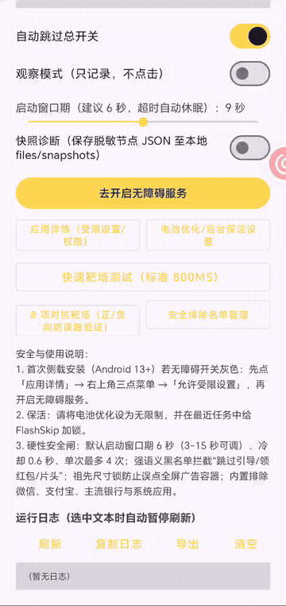

# FlashSkip（闪跳）

[](https://kotlinlang.org)
[-3DDC84.svg)](https://developer.android.com)
[](#隐私与安全设计)

**FlashSkip** 是一款基于 Android 无障碍服务（`AccessibilityService`）的事件驱动开屏广告自动跳过工具——**无需 Root、零网络权限、纯本地运行**。通过纯 Kotlin 编写的规则与状态机引擎，在极短延迟内识别并点击“跳过”按钮，同时内置多层防误触机制，防止误点全屏广告落地页或正常业务按钮。

---

## 实机跳过演示与毫秒级耗时记录

以下演示录制于荣耀真机（Android 16，已裁剪顶部状态栏），连续展示了三种典型开屏形态：**标准可点按钮**、**全屏可点击父容器陷阱（防误触落地页）**、以及 **广告 SDK 对 `ACTION_CLICK` 假成功时的自动手势升级**：

<p align="center">
  
</p>

> 高清视频文件：[docs/media/flashskip-demo.mp4](docs/media/flashskip-demo.mp4)

### 本次录屏实测耗时明细（广告按钮出现 → 广告关闭）

| 场景 | 跳过按钮出现时刻 | 广告关闭时刻 | 出现 → 关闭耗时 | 执行方式与说明 |
|---|---|---|---|---|
| **1. 标准可点跳过 (`standard`)** | `00:06:15.011` | `00:06:15.030` | **`19 ms`** | `NODE_ACTION` (`attempt=1`)，节点一渲染即瞬间点击关闭 |
| **2. 全屏可点击父容器陷阱 (`fullscreen_parent`)** | `00:06:17.804` | `00:06:17.876` | **`72 ms`** | 祖先尺寸锁拦截全屏广告容器，拒绝攀爬父节点，直接向小按钮中心发出安全 `GESTURE`（0 误触） |
| **3. `ACTION_CLICK` 假成功升级 (`fake_success`)** | `00:06:20.897` | `00:06:21.494` | **`597 ms`** | 第 1 次 `NODE_ACTION` 被广告 SDK 假成功忽略 → `+258ms` 验证未关闭并触发 `RETRY_ESCALATE` → 冷却结束自动升级 `GESTURE` 关闭 |

<details>
<summary>点击展开本次录屏对应的原始实测日志（精确到毫秒）</summary>

```text
[2026-11-19 00:06:15.011] TEST_LAB[standard] skip button shown
[2026-11-19 00:06:15.030] TEST_PASS[standard] closed, buttonVisibleFor=19ms
[2026-11-19 00:06:15.053] NODE_ACTION pkg=com.flashskip text='跳过 3s' via=text shake=false b=860,173,1148,304 scr=1200x2664 sinceLaunch=720ms attempt=1
[2026-11-19 00:06:15.138] VERIFIED pkg=com.flashskip (window changed, latency=720ms)

[2026-11-19 00:06:17.804] TEST_LAB[fullscreen_parent] fullscreen trap + small skip shown
[2026-11-19 00:06:17.813] GESTURE pkg=com.flashskip text='跳过' via=text shake=false b=860,173,1148,304 scr=1200x2664 sinceLaunch=439ms attempt=1
[2026-11-19 00:06:17.876] TEST_PASS[fullscreen_parent_safe_gesture] closed, buttonVisibleFor=72ms
[2026-11-19 00:06:17.902] GESTURE_OK at=1004,238
[2026-11-19 00:06:18.008] VERIFIED pkg=com.flashskip (window changed, latency=439ms)

[2026-11-19 00:06:20.897] TEST_LAB[fake_success] fake-success skip shown
[2026-11-19 00:06:20.920] TEST_LAB[fake_success] fake-success ACTION_CLICK ignored!
[2026-11-19 00:06:20.922] NODE_ACTION pkg=com.flashskip text='跳过' via=text shake=false b=860,173,1148,304 scr=1200x2664 sinceLaunch=457ms attempt=1
[2026-11-19 00:06:21.180] RETRY_ESCALATE pkg=com.flashskip (still present, next attempt uses GESTURE)
[2026-11-19 00:06:21.428] GESTURE pkg=com.flashskip text='跳过' via=text shake=false b=860,173,1148,304 scr=1200x2664 sinceLaunch=958ms attempt=2
[2026-11-19 00:06:21.494] TEST_PASS[fake_success_escalated_gesture] closed, buttonVisibleFor=597ms
[2026-11-19 00:06:21.521] GESTURE_OK at=1004,238
[2026-11-19 00:06:21.698] VERIFIED pkg=com.flashskip (window changed, latency=958ms)
```

</details>

### 8 项对抗靶场全量回归结果

内置 [TestSplashActivity.kt](app/src/main/java/com/flashskip/TestSplashActivity.kt) 对抗靶场在真机上全部通过（**`PASS = 8 / 8, FAIL = 0`**）：

- **5 项正向跳过**：`standard`（标准可点）、`non_clickable`（不可点击自绘控件手势）、`fullscreen_parent`（全屏可点击父容器陷阱防误点）、`fake_success`（`ACTION_CLICK` 假成功自动升级手势）、`desc_only`（空 `text` + `contentDescription`）均 100% 自动关闭。
- **3 项负向防误触对照**：`neg_guide`（“跳过引导”）、`neg_redpacket`（“点击跳过领红包”）、`neg_center`（屏幕正中“跳过”按钮，含窗口滑入动画偏移场景）均 **0 次误触**。

---

## 核心架构与工程特性

项目采用 **纯 Kotlin 核心引擎（`:core`）与 Android 壳层（`:app`）彻底解耦** 的分层设计：

```text
core/ (纯 Kotlin JVM 模块，零 Android 依赖，支持毫秒级快照回放单测)
 ├── Models.kt            不可变节点/窗口快照模型，避免空字符串 text 遮蔽 contentDescription
 ├── PackagePolicy.kt     系统/OEM/输入法及 19 个银行支付应用默认强排除；瞬态弹窗隔离
 ├── RuleIndex.kt         按包名 O(1) 索引规则库（内置主流聚合 SDK viewId 规则）
 ├── SkipMatcher.kt       三层防误触匹配器 + 摇一摇抢跑检测 + 自绘无文字跳过节点识别
 ├── SkipStateMachine.kt  启动窗口期/冷却/假成功升级/跨应用防污染校验/息屏解锁重布防状态机
 └── SnapshotJson.kt      脱敏 UI 节点树 JSON 导出，用于回归测试 fixture

app/ (Android 服务、保活与界面层)
 ├── SkipAdService.kt     极薄接入层：最新内容事件合并、FIFO 状态边沿队列、多窗口扫描、静默前台守护
 ├── a11y/NodeExtractor   单次迭代 BFS 提取快照并 100% recycle 原生节点，杜绝 Binder/池泄漏
 ├── a11y/ActionExecutor  节点点击 + 屏幕安全边界裁剪手势点击
 ├── data/SkipLog & StatsStore  独立写线程双文件轮转日志 + 本地 P50/P95 延迟统计
 ├── keepalive/PermissionHelper 精确 ComponentName 检测、一键电池白名单弹窗与 OEM 保活指引
 └── MainActivity / TestSplashActivity  仪表盘、安全排除名单管理、日志导出与 8 项对抗靶场
```

---

## 隐私与安全设计

- **硬核防误触**：
  - 精准词边界正则 + 强语义黑名单（一票否决“引导 / 教程 / 此步 / 登录 / 片头 / 领取 / 下载 / 红包”等文案）；
  - **祖先尺寸锁**：向上寻找可点击容器时严格限制尺寸上限，遇到全屏广告父容器立即截断，绝不误点广告主体；
  - **窗口归一化区域校验**：相对根节点 `rootBounds` 校验角落/边缘区域，防止开屏动画滑入偏移导致中心按钮误判；
  - 默认强排除系统组件、主流输入法与微信/支付宝/云闪付/主流银行等敏感应用；支持自定义排除包名。
- **极简权限与本地隐私**：
  - **不申请 `INTERNET` 权限**，无任何联网行为；
  - 所有跳过统计、运行日志与诊断快照仅保存在本机应用私有目录。

---

## 构建、测试与验证

### 1. 环境要求与命令行构建

- **环境要求**：JDK 17、Android SDK（`compileSdk 34` / `buildTools 36.0.0`）、Gradle 8.x（或直接用 Android Studio 打开根目录同步构建）。
- 使用本地 Gradle 运行全部单元测试并构建 Debug APK：

  ```bash
  gradle :core:test :app:testDebugUnitTest :app:assembleDebug
  ```

- 生成 APK 默认输出在 `app/build/outputs/apk/debug/app-debug.apk`。若 Windows 用户目录包含非 ASCII 字符导致 Gradle/AGP 路径异常，建议将工程复制到纯英文路径下构建。

### 2. 在设备端进行靶场验证

安装并在系统“无障碍设置”中开启 **FlashSkip**（Android 13+ 需先在“应用信息 → 右上角菜单”允许受限设置）后，可通过以下任意方式验证全部 8 项对抗场景：

- **方式 A（应用内点击）**：打开 FlashSkip 主界面，点击「靶场测试 / 多场景选择」，依次体验 5 项正向跳过与 3 项负向防误触对照页；
- **方式 B（`adb` 命令行拉起指定场景）**：

  ```bash
  adb shell am start -n com.flashskip/.MainActivity --es launch_scenario standard
  ```

  可选场景值：`standard`、`non_clickable`、`fullscreen_parent`、`fake_success`、`desc_only`、`neg_guide`、`neg_redpacket`、`neg_center`。
